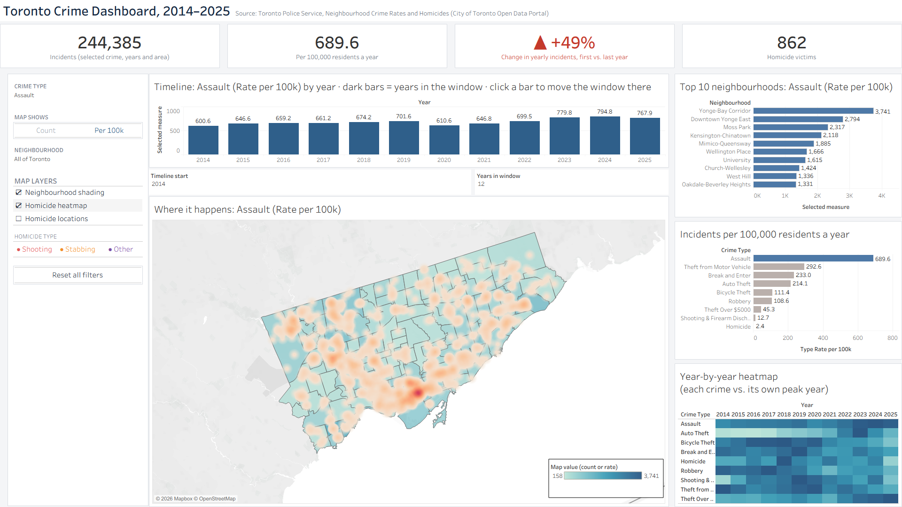
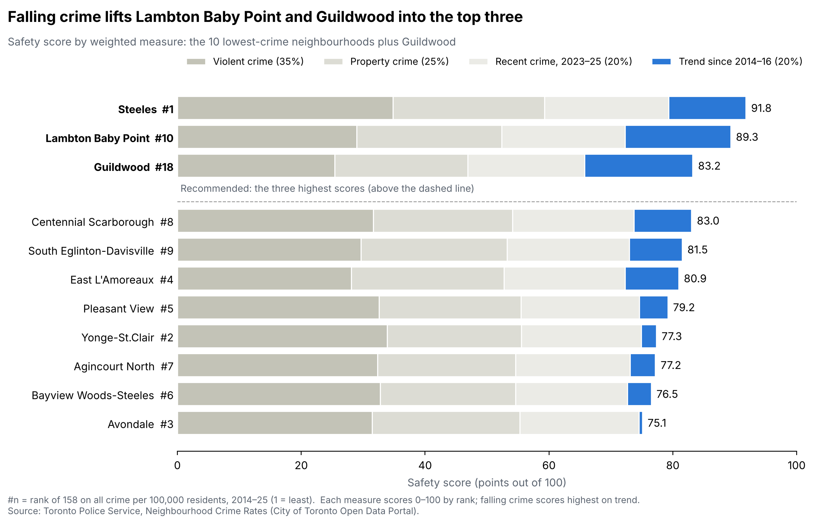

# Toronto Crime Dashboard, 2014–2025

**[▶ Open the interactive dashboard](https://YOUR-GITHUB-USERNAME.github.io/toronto-crime-dashboard/)** · [View on Tableau Public](PASTE_YOUR_TABLEAU_PUBLIC_LINK)

An interactive Tableau dashboard of reported crime in Toronto's 158 neighbourhoods. It answers one question for a home buyer: **which neighbourhoods are safest?** Built for MBAN 5140 Data Visualization at the Schulich School of Business.

## Key findings

- **Steeles, Lambton Baby Point and Guildwood** have the highest weighted safety scores (91.8, 89.3 and 83.2 out of 100). Their crime rates are 40–62% below the city average.
- Toronto's crime rate rose 11% between 2014–16 and 2023–25, from 1,619 to 1,791 per 100,000 residents a year. Auto theft and assault drove the rise.
- A low crime rate is not enough: all eight neighbourhoods ranked 2nd to 9th on raw crime saw crime grow faster than the city.

The safety score weights violent crime 35%, property crime 25%, crime in 2023–25 20%, and the trend since 2014–16 20%. Each measure is scored 0–100 by its rank among the 158 neighbourhoods. The calculation is in [`Figure2_Safety_Score.ipynb`](Figure2_Safety_Score.ipynb).

## Dashboard features

- **Map:** crime by neighbourhood as a count or per 100,000 residents, with a homicide heatmap and homicide locations.
- **Filters:** crime type, neighbourhood, map measure, homicide type and map layers.
- **Time window:** sliders for the start year and the number of years shown.
- **Linked views:** a click on the map, the Top 10 bars, the crime mix or the year heatmap updates the other charts.
- **KPI cards:** incidents, rate per 100,000, change over the window and homicide victims.

## Data

[City of Toronto Open Data Portal](https://open.toronto.ca), Toronto Police Service:

- Neighbourhood Crime Rates: 9 crime types, 158 neighbourhoods, 2014–2025, reshaped to 17,064 rows.
- Homicides: 805 incidents and 862 victims, 2014–2025.
- Neighbourhood boundaries (GeoJSON).

## Files

| File | What it is |
|---|---|
| `index.html` | Web page that embeds the live dashboard (served by GitHub Pages) |
| `Toronto_Crime_Dashboard_Myles_Li.twbx` | Tableau packaged workbook (data included) |
| `Figure2_Safety_Score.ipynb` | Python notebook: safety score and Figure 2 |
| `data/` | Cleaned crime data (Excel) and neighbourhood boundaries (GeoJSON) |
| `images/` | Dashboard screenshot and Figure 2 |

## How to open

- **No install:** use the interactive link at the top.
- **Workbook:** download the `.twbx` and open it in Tableau Desktop or the free Tableau Public app.
- **Notebook:** run it from the repository folder with pandas, matplotlib and openpyxl installed.

---
Myles Li · Tableau Desktop 2026.2 · Python (pandas, matplotlib)
